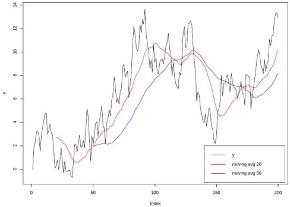
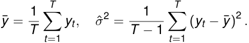
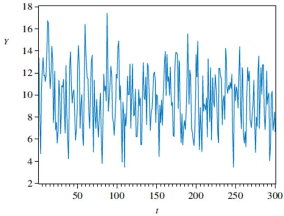
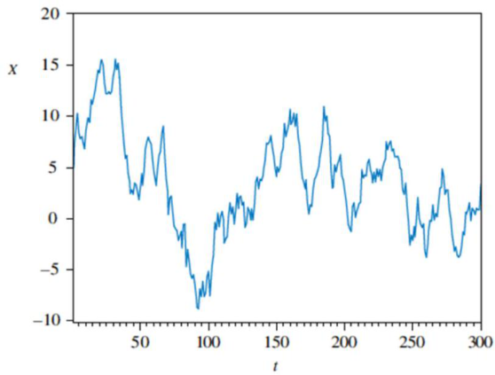
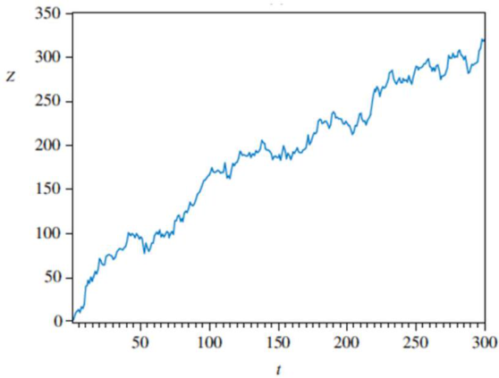
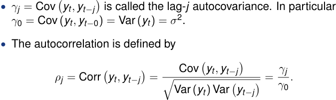
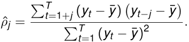
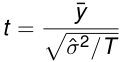
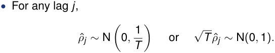
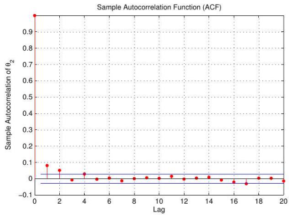

**Basic concepts in time series R Demonstration** 

# **Week 6: Time Series Models (I)** 

Yi Ding 

Department of Finance and Business Economics, University of Macau 

yiding@um.edu.mo 

**Yi Ding Week 6: Time Series Models (I)** 

**Basic concepts in time series R Demonstration** 

# **Summary of week 5 lecture** 

- Multiple linear regression: _y_ = _β_ 0 + _β_ 1 _x_ + _. . ._ + _βk xk_ + _u_ . 

- _•_ Properties of the OLS estimation **_β_**� . 

- _t_ test and _F_ test in multiple linear regression. 

**Yi Ding Week 6: Time Series Models (I)** 

**Basic concepts in time series R Demonstration** 

# **Outline of Lecture 6** 

> **1** Basic concepts in time series 

> **2** R Demonstration 

**Yi Ding Week 6: Time Series Models (I)** 

**Basic concepts in time series R Demonstration** 

# **Basic Concepts in Time Series** 

**Yi Ding Week 6: Time Series Models (I)** 

**Basic concepts in time series R Demonstration** 

# **Time series plot** 

Suppose we have time series _yt_ as plotted in the follow graph, where we calculate mean (average) by using every 20 data points and 50 data points. 

**Yi Ding Week 6: Time Series Models (I)** 

**Basic concepts in time series R Demonstration** 

# **Time series plot (cont’)** 

Similarly, we calculate standard deviation by using every 20 data points and 50 data points. 

**Yi Ding Week 6: Time Series Models (I)** 

**Basic concepts in time series R Demonstration** 

# **Observation from the plots** 

- Unstable average. 

- Unstable standard deviation. 

- Changing the calculation interval from 20 to 50 results in changes in the mean and standard deviation. 

**Yi Ding Week 6: Time Series Models (I)** 

**Basic concepts in time series R Demonstration** 

# **Stationarity** 

- Strict stationarity: distributions are time-invariant. 

- Weak stationarity: 

   - E [ _yt_ ] = _µ_ for all _t_ 

   - Var ( _yt_ ) = _σ_2 for all _t_ 

   - Cov ( _yt , yt−j_ ) = _γj_ depends on _j_ and not on _t_ 

We will mainly focus on “weak stationary time series". 

**Yi Ding Week 6: Time Series Models (I)** 

**Basic concepts in time series R Demonstration** 

# **Sample mean and sample variance** 

<!-- Start of picture text -->
T T 1 y ¯ = T 1 � yt , σ ˆ 2 = T − 1 � ( yt − y ¯) 2 . t =1 t =1 <!-- End of picture text -->

**Yi Ding Week 6: Time Series Models (I)** 

**Basic concepts in time series R Demonstration** 

# **Stationary time series plot** 

**Yi Ding Week 6: Time Series Models (I)** 

**Basic concepts in time series R Demonstration** 

# **Nonstationary (wandering) time series plot** 

**Yi Ding Week 6: Time Series Models (I)** 

**Basic concepts in time series R Demonstration** 

# **Nonstationary (trending) time series plot** 

**Yi Ding Week 6: Time Series Models (I)** 

**Basic concepts in time series R Demonstration** 

# **Autocorrelation** 

<!-- Start of picture text -->
• γj = Cov � yt , yt−j � is called the lag- j autocovariance. In particular γ 0 = Cov ( yt , yt− 0) = Var ( yt ) =  σ 2 . • The autocorrelation is defined by = Cov � yt , yt−j � . ρj = Corr � yt , yt−j � � Var ( yt ) Var � yt−j � = γ γ 0 j <!-- End of picture text -->

- Sample autocorrelation: 

<!-- Start of picture text -->
� Tt =1+ j ( yt − y ¯) � yt−j − y ¯� . ρ ˆ j = � Tt =1 ( yt − y ¯)2 <!-- End of picture text -->

**Yi Ding Week 6: Time Series Models (I)** 

**Basic concepts in time series R Demonstration** 

# **Remarks on autocorrelation** 

- Note that it is because of stationarity, that the autocorrelation (autocovariance) is meaningful. 

- For stationary time series, the relation (correlation) among _yt_ does not depend on when we observed them, but only depends on the amount of time in between. For example, the correlation between ( _Y_ Jan _, Y_ Mar) is the same as the correlation between ( _Y_ Dec _, Y_ Feb), and the correlation between ( _y_ 1 _, y_ 6) is the same as the correlation of ( _y_ 24 _, y_ 29). 

**Yi Ding Week 6: Time Series Models (I)** 

**Basic concepts in time series R Demonstration** 

# **Remarks on autocorrelation (cont’)** 

- Suppose we have the following time series sample: 

         - _y_ 1 _, y_ 2 _, . . . , y_ 10 

- Calculating _ρ_ 1 will use the sample pairs: 

      - ( _y_ 1 _, y_ 2) _,_ ( _y_ 2 _, y_ 3) _,_ ( _y_ 3 _, y_ 4) _,_ ( _y_ 4 _, y_ 5) ( _y_ 5 _, y_ 6) _,_ ( _y_ 6 _, y_ 7) _,_ ( _y_ 7 _, y_ 8) _,_ ( _y_ 8 _, y_ 9) _,_ ( _y_ 9 _, y_ 10) 

- Calculating _ρ_ 4 will use the sample pairs: 

   - ( _y_ 1 _, y_ 5) _,_ ( _y_ 2 _, y_ 6) _,_ ( _y_ 3 _, y_ 7) _,_ ( _y_ 4 _, y_ 8) _,_ ( _y_ 5 _, y_ 9) _,_ ( _y_ 6 _, y_ 10) 

**Yi Ding Week 6: Time Series Models (I)** 

**Basic concepts in time series R Demonstration** 

# **Testing the mean** 

> **1** _H_ 0 : _µ_ = 0 vs _H_ 1 : _µ̸_ = 0. 

> **2** Test statistic ( _t_ -ratio): 

<!-- Start of picture text -->
y ¯ t = � σ ˆ 2 /T <!-- End of picture text -->

> **3** Look up N(0 _,_ 1) distribution for rejection regions with 10%, 5% _,_ 1% significance levels. 

**Yi Ding Week 6: Time Series Models (I)** 

**Basic concepts in time series R Demonstration** 

# **Testing individual autocorrelation** _• H_ 0 : _ρj_ = 0 vs _H_ 1 : _ρj̸_ = 0. 

<!-- Start of picture text -->
• For any lag  j , ρ ˆ j ∼ N 0 , 1 or √ T  ˆ ρj ∼ N(0 ,  1) . � T � <!-- End of picture text -->

**Yi Ding Week 6: Time Series Models (I)** 

**Basic concepts in time series R Demonstration** 

**Testing multiple autocorrelation (the portmanteau test).** 

_• H_ 0 : _ρ_ 1 = _· · ·_ = _ρm_ = 0 vs _H_ 1 : _ρj̸_ = 0. _• T_ ˆ _ρ_2 _j_= � _~~√~~ T_ ˆ _ρj_ �2 _∼ χ_2 1. _•_ Construct the Box-Pierce _Q_ -statistic: _m QBP_ ( _m_ ) = _T_ � _ρ_ ˆ2 _j__∼χ_ _m_2 _j_ =1 

- A modification of _QBP_ is the Ljung-Box _Q_ -statistic: 

> _m_ 1 _QLB_ ( _m_ ) = _T_ ( _T_ + 2) � _ρ_ ˆ2 _j__∼χ_ _m_2_._ <mark>�</mark> _T − j_ <mark>�</mark> _j_ =1 

**Yi Ding Week 6: Time Series Models (I)** 

**Basic concepts in time series R Demonstration** 

The sample autocorrelation function plots _ρ_ ˆ _j_ against _j_ , with the 95% confident interval (see the blue lines) 

**Yi Ding Week 6: Time Series Models (I)** 

**Basic concepts in time series R Demonstration** 

# **R Demonstration** 

**Yi Ding Week 6: Time Series Models (I)** 

